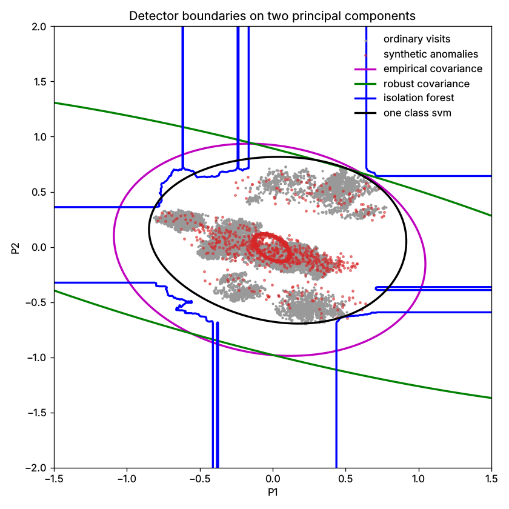
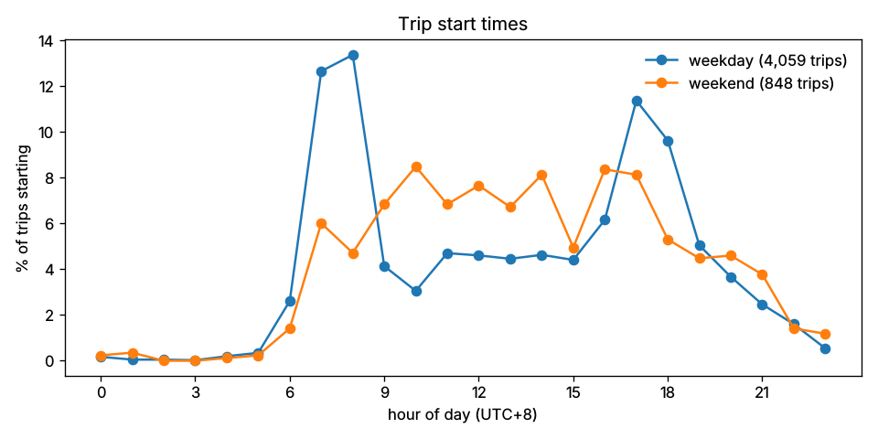

# Spotting unusual visits in multiday GPS travel diaries

Can a model trained only on where and when people normally go flag a visit that doesn't fit, such as someone turning up somewhere they have never been, at an hour they never travel? This project builds that experiment on the Shanghai multiday GPS study: 281 participants, 10,408 trip and activity records, and 20,816 timestamped visits, scored by four unsupervised detectors.

## What it found

**Out-of-place locations are easy. Plausible places visited by the wrong person are the hard case.**

Rerunning the full experiment with `pipeline.py` (no road-network features, seed 13, 2,000 synthetic anomalies):

| Detector | False alarms on held-out real visits | Caught: visit far outside the study area | Caught: another participant's real location |
| --- | ---: | ---: | ---: |
| Elliptic Envelope (empirical covariance) | 0.00% | 100% | 0% |
| Elliptic Envelope (robust covariance) | 0.00% | 100% | 0% |
| Isolation Forest | 0.02% | 100% | 0% |
| One-Class SVM | 8.7% | 100% | 47.5% |

The covariance and Isolation Forest models, tuned to an expected anomaly rate of about 5 in a million (the abduction-rate prior used throughout), almost never raise a false alarm and catch every visit that lands outside the participants' range. None of them notices a participant appearing at a place that another participant visits. The One-Class SVM catches nearly half of those swaps, at the cost of flagging about 1 in 11 ordinary visits. Full numbers are in [`docs/results_shanghai.json`](docs/results_shanghai.json).

The original notebook run (with nearest walking-network node features from OSMnx) reported the same split between models: the covariance models and Isolation Forest flagged 1 of 15,612 training visits and 0 of 5,204 held-out visits, the One-Class SVM flagged 1,362 (8.7%) and 460 (8.8%), and all four caught all 2,000 synthetic visits. Its visit generator passed latitude and longitude in swapped order, so every synthetic visit landed far from Shanghai; `pipeline.py` fixes that, which is what exposes the cross-participant case.



Squeezed onto two principal components, the synthetic anomalies sit inside every detector's boundary. They only separate in the 15 components that keep 99% of the variance, which is the space the table above is scored in.

### The travel behind it

- 4,907 trips and 5,501 activities, a median of 34 records per participant, recorded from October 2013 to December 2015, most of them from April 2014 on.
- The median trip lasts 19.5 minutes and covers 2.7 km in a straight line; one trip in ten goes further than 14.9 km.
- Mode share: walking 23%, bus 22%, car 20%, subway 15%, bicycle 8%, e-bicycle 5%, shuttle 3%, other 4%.
- Weekday trips peak sharply at 7–9 am and 5–7 pm. Weekend trips spread across the day.



## Approach

1. **Records to features.** Each trip gets its duration, calendar fields (month, day, weekday, hour, minute), great-circle and Manhattan distance, and bearing.
2. **Trips to visits.** Every record's start and end become two timestamped visits: who, where, when.
3. **Synthetic anomalies.** Two kinds, generated per participant at a random time up to a year past the end of the study: *displaced* visits at coordinates outside the study area's bounding box, and *cross* visits at a real location belonging to a different participant.
4. **Encoding and reduction.** Participant IDs (and nearest road-network nodes, with `--road-network`) are hash-encoded into 8 columns; features are standardised and reduced with PCA to 99% of the variance.
5. **Detectors.** Elliptic Envelope (empirical and robust covariance), Isolation Forest and One-Class SVM are fit on 75% of real visits and scored on the other 25% and on the synthetic set.

`gps_package.py` holds the object model the notebooks grew out of: `Visit`, `Trip`, `User` and `Community` classes, distance and bearing helpers, synthetic trip generation, and a `gps_anomaly_detector` wrapper with an Isolation Forest / Elliptic Envelope / Bayesian Gaussian Mixture / One-Class SVM ensemble.

## Get the data

The data is the [Multiday GPS tracking data of Shanghai](https://doi.org/10.21227/fqe8-db87) on IEEE DataPort (DOI 10.21227/fqe8-db87), downloaded under the terms on that page. Sign in, download the Excel workbook, then install it:

```bash
python scripts/prepare_data.py ~/Downloads/<workbook>.xlsx
```

This checks the first sheet's header, prints the record and participant counts (10,408 and 281 for the version used here), compares the SHA-256 with that version (`aaf900db…080f`), and copies the file to `data/shanghai_multiday_gps.xlsx`. Only the first sheet, the trip and activity records, is read.

No account? Generate a synthetic workbook with the same layout and run everything on that:

```bash
python scripts/make_sample_data.py            # data/sample_gps.xlsx: 40 participants, ~2,600 records
```

## Run it

```bash
python -m venv .venv && source .venv/bin/activate
pip install -r requirements.txt

python scripts/prepare_data.py ~/Downloads/<workbook>.xlsx   # or: python scripts/make_sample_data.py
python pipeline.py                                          # or: python pipeline.py --data data/sample_gps.xlsx
python -m unittest discover -s tests
```

`pipeline.py` takes about 15 seconds on the full dataset and writes `outputs/metrics.json`, `outputs/figures/trip_starts_by_hour.png` and `outputs/figures/decision_boundaries.png`. Add `--road-network` to download Shanghai's walking network with OSMnx and include each visit's nearest node and distance to it, as the notebook did (the download is large and takes several minutes). `--synthetic`, `--seed` and `--output-dir` change the rest.

The tests run without any dependencies installed (the module tests stub them); with `requirements.txt` installed they also run the pipeline end to end on a small synthetic workbook and check the road-network features on a toy graph.

The notebooks read `GPS_DATA_PATH` or default to `data/shanghai_multiday_gps.xlsx`. They were written against 2021-era libraries; `requirements-notebooks.txt` pins that environment (Python 3.8).

## Layout

```
pipeline.py                 end-to-end experiment: features, synthetic anomalies, detectors, metrics, figures
gps_package.py              Visit / Trip / User / Community objects, helpers, gps_anomaly_detector
scripts/prepare_data.py     validate the downloaded workbook and install it in data/
scripts/make_sample_data.py synthetic workbook with the source layout
final_notebook.ipynb        the main experiment as originally run, with its plots and model comparison
eda.ipynb                   earlier exploration: distributions, road-network visit counts, first models
package_demo.ipynb          gps_package walkthrough: users, communities, synthetic trips, detector
docs/                       figures and metrics from the full-data run
tests/                      module tests (stubbed dependencies) and pipeline tests
```
